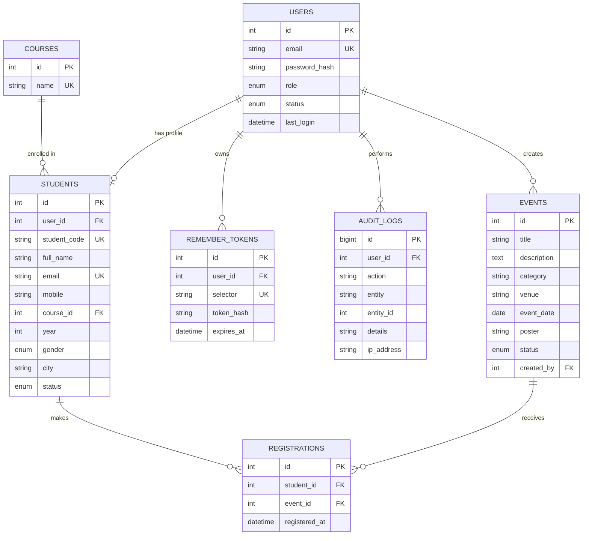

# ER diagram

Normalisation notes: course names live only in `courses` (3NF); the many-to-many link between students and events is the
`registrations` table with a UNIQUE (student_id, event_id) pair; login data (`users`) is separate from profile data (`students`).

## REST-style route plan
| Method | Route | Purpose |
|---|---|---|
| GET | `api/students.php` | list (search, filter, pagination) |
| GET | `api/students.php?id=5` | one student |
| POST | `api/students.php` | create |
| PUT | `api/students.php?id=5` | update |
| DELETE | `api/students.php?id=5` | soft delete |
| GET | `api/events.php` | list events (public) |
